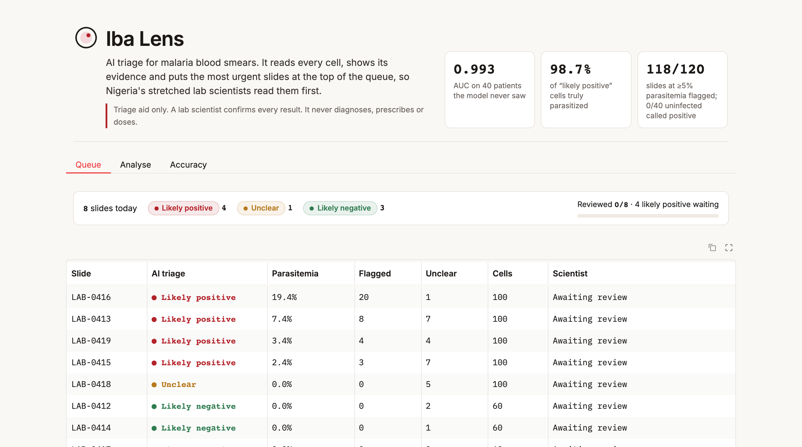
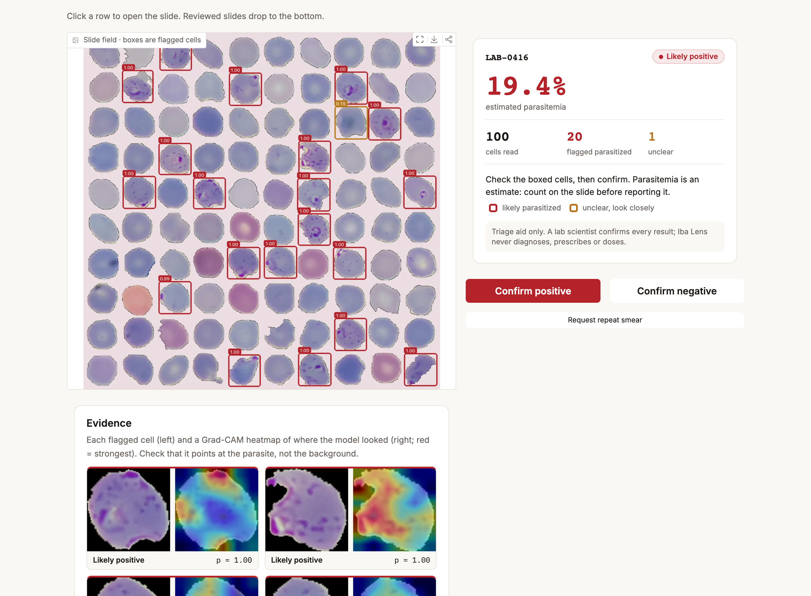
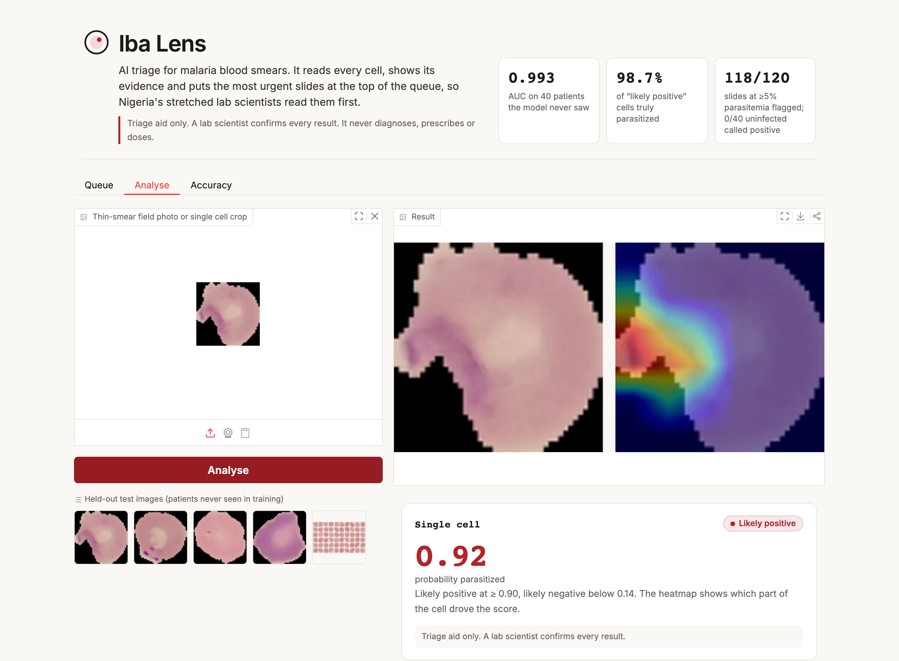
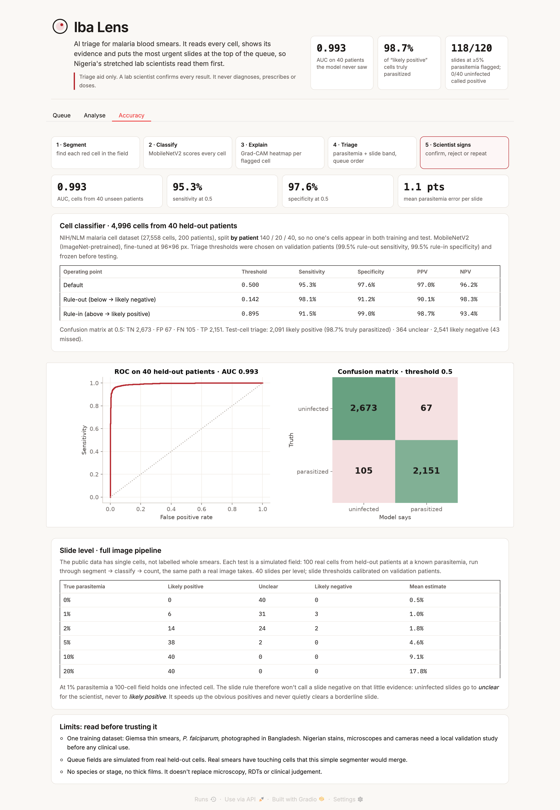
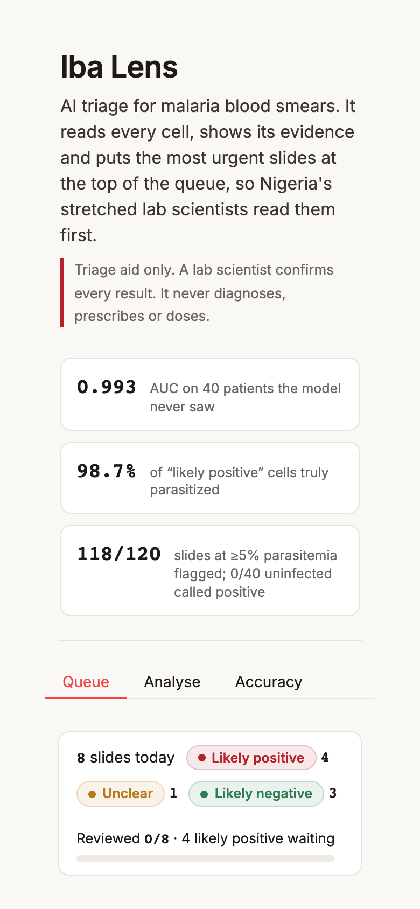
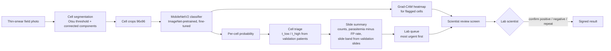
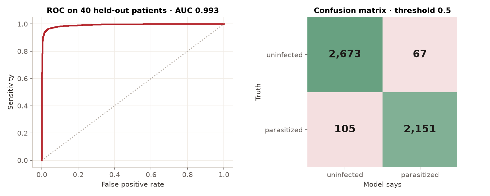

# Iba Lens: malaria smear triage for Nigerian labs

*Ibà* is Yoruba for malaria fever.

Iba Lens reads every red blood cell on a thin-smear image. It flags the cells that look parasitized and shows a heatmap of what it saw in each one. It estimates parasitemia and sorts the lab queue so the scientist reads the most urgent slides first. **A lab scientist confirms every result. Iba Lens never diagnoses, prescribes or doses.**

ForgeHacks 2026 · AI + Healthcare track

| | |
|---|---|
| Live demo | _Hugging Face Space link goes here_ |
| Demo video | _YouTube link goes here_ |
| Model | MobileNetV2, fine-tuned on 27,558 NIH/NLM cell images (`models/`) |
| Test result | **AUC 0.993** on 40 patients the model never saw |



## Submission checklist

- [x] Source code with a reproducible pipeline (data → train → calibrate → evaluate → app)
- [x] Working AI build: the trained model is in the repo, and `python app.py` runs it
- [x] Held-out test metrics: sensitivity, specificity, PPV, NPV, AUC, confusion matrix (`results/`)
- [x] Architecture diagram (below) and screenshots (`docs/`)
- [ ] Public demo video, 2–4 min
- [ ] Deployment link

## The problem

Nigeria carries the world's largest malaria burden: about 26% of global cases and 31% of global malaria deaths in 2023 ([World Malaria Report 2024 via ICIR](https://www.icirnigeria.org/nigeria-still-carries-worlds-highest-malaria-burden/)). WHO says every suspected case should be confirmed by microscopy or an RDT before treatment ([WHO](https://www.who.int/news-room/fact-sheets/detail/malaria)). In practice that confirmation is often skipped or late:

- **Up to 83% of suspected malaria patients are treated without lab confirmation.** A Lagos primary health centre study found 83.1% overtreatment in under-fives ([Guardian Nigeria, 2025](https://guardian.ng/features/health/how-malaria-misdiagnoses-others-trigger-dire-outcomes/)).
- **More than half of patients diagnosed on symptoms alone in Enugu had no parasites on testing** ([Uzochukwu et al., Malaria Journal 2009](https://malariajournal.biomedcentral.com/articles/10.1186/1475-2875-8-265)).
- **The people who read smears are leaving.** 10,697 medical laboratory scientists have emigrated, over 4,504 of them in 2023 ([NAN](https://nannews.ng/2023/12/31/10697-medical-laboratory-scientists-leave-nigeria-registrar)).

Fewer scientists are reading more slides. Urgent slides wait behind routine ones, fevers get treated as malaria by default, and the real cause (typhoid, Lassa, dengue) is missed.

## Who it is for

Medical laboratory scientists in Nigerian hospital and primary-care labs who read Giemsa-stained thin smears. They upload a field photo taken through the microscope. Iba Lens pre-reads it in seconds, and the scientist starts with the slides most likely to be positive, looking at the cells it highlighted.

## What it does

1. **Finds the cells.** The image is thresholded and its connected regions split into single red blood cells (`src/smearscan.py: segment`).
2. **Scores each cell.** A fine-tuned MobileNetV2 gives each cell a probability of being parasitized.
3. **Shows its evidence.** Each flagged cell gets a Grad-CAM heatmap of the region that drove its score, so the scientist can check the parasite rather than trust a number.
4. **Triages the cell, then the slide.** Two thresholds frozen on validation patients split cells into *likely positive*, *unclear* and *likely negative*. A slide's band comes from its counts, using slide thresholds calibrated on validation slides. Parasitemia is estimated with the false-positive rate subtracted.


5. **Keeps the human in charge.** The queue is ordered by band and parasitemia. The scientist confirms positive, confirms negative or asks for a repeat smear; the slide drops out of the review list and the next most urgent one opens.

## Screens

| Analyse a single cell | Accuracy page | Phone |
|---|---|---|
|  |  |  |

Design notes are in [design.md](design.md): a light "lab report" look, one accent colour, status colours only for triage, and the safety line always visible.

## Architecture



Training pipeline (`src/`):

| Step | Script | Output |
|---|---|---|
| Patient-grouped split | `prep_data.py` | `data/cells_96.npz`, `results/split_summary.json` |
| Fine-tune MobileNetV2 (6 epochs, ~4 min on Apple Silicon) | `train.py` | `models/malaria_mobilenetv2_96.pt` |
| Pick thresholds on validation, score test | `calibrate.py` | `models/thresholds.json`, `results/metrics.json` |
| Slide-level evaluation with the full image pipeline | `evaluate_slides.py` | `results/slide_metrics.json` |
| Demo queue and figures | `make_demo_assets.py` | `assets/` |

## How well it works

### Cell level: 4,996 cells from 40 held-out patients

The NIH/NLM dataset has 27,558 cells from 200 patients. I split it **by patient**: 140 for training, 20 for validation, 40 for test. Cells from the same person never appear in two splits, so the test numbers measure performance on new patients, not on near-duplicates of training images.

| Operating point | Threshold | Sensitivity | Specificity | PPV | NPV |
|---|---|---|---|---|---|
| Default | 0.50 | 95.3% | 97.6% | 97.0% | 96.2% |
| Rule-out (below = *likely negative*) | 0.142 | 98.1% | 91.2% | 90.1% | 98.3% |
| Rule-in (above = *likely positive*) | 0.895 | 91.5% | 99.0% | 98.7% | 93.4% |

**AUC 0.9929.** Confusion matrix at 0.5: TN 2,673 · FP 67 · FN 105 · TP 2,151. Both triage thresholds were chosen on the validation patients (99.5% sensitivity for rule-out, 99.5% specificity for rule-in) and frozen before testing.

How the test cells were triaged: 2,091 *likely positive*, of which 98.7% were truly parasitized. 364 *unclear* (7% of cells), sent for a closer look. 2,541 *likely negative*, which missed 43 parasitized cells.



### Slide level: the full image pipeline

The public dataset has single cells, not labelled whole smears. To test the full pipeline, I built simulated microscope fields: real cells from held-out patients laid out on a slide background at a known parasitemia. Each field then goes through segment → classify → count, the same path a real image takes. Slide thresholds were calibrated on validation-patient slides and tested on test-patient slides (40 per level, 100 cells each).

| True parasitemia | Likely positive | Unclear | Likely negative | Mean estimate |
|---|---|---|---|---|
| 0% | 0 | 40 | 0 | 0.5% |
| 1% | 6 | 31 | 3 | 1.0% |
| 2% | 14 | 24 | 2 | 1.8% |
| 5% | 38 | 2 | 0 | 4.6% |
| 10% | 40 | 0 | 0 | 9.1% |
| 20% | 40 | 0 | 0 | 17.8% |

The segmenter found every cell (100 of 100 on every field). 97.5% of infected slides stayed out of *likely negative*, no uninfected slide was called positive, and the mean parasitemia error was 1.1 percentage points.

**Why uninfected 100-cell slides come out "unclear".** At 1% parasitemia, a 100-cell field holds one infected cell, which looks much like the occasional false positive. The slide rule is deliberately conservative: it won't rule a slide out on that little evidence, so those slides go to the scientist rather than to the bottom of the queue. The tool saves reading time on the obvious positives and never quietly clears a borderline slide. Reading more fields per patient, as labs already do, would let it rule out with confidence.

**Speed:** about 1.8 s per 100-cell field on a laptop CPU, about 6 s with heatmaps for every flagged cell.

### In context

Published per-cell results on this dataset reach AUC 0.999 with larger networks ([Rajaraman et al. 2018](https://lhncbc.nlm.nih.gov/LHC-publications/PDF/pub9752.pdf)). Field evaluations of automated microscopes are far lower: EasyScan GO had 91% sensitivity and 76% specificity across 11 sites, and 57% sensitivity below 200 parasites/µL ([IDDO / Malaria Journal 2022](https://www.iddo.org/node/1649)). That gap is why Iba Lens is a triage aid with a scientist confirming, not an automated diagnosis.

## Limitations

- **One dataset.** Giemsa-stained thin smears, *P. falciparum*, photographed with a phone on a microscope at Chittagong Medical College, Bangladesh. Nigerian labs use different stains, microscopes and cameras, so a local validation study against expert microscopy (and PCR) is needed before any clinical use.
- **Simulated fields.** Real smears have touching and overlapping cells, platelets, white blood cells and stain debris. This simple segmenter would merge touching cells; real-smear segmentation is the next engineering step.
- **No species or stage.** It only answers "parasitized or not", and it doesn't handle thick films.
- **Not a diagnostic device.** It doesn't replace microscopy, RDTs or clinical judgement, and it gives no treatment or dosing advice.

## Run it yourself

```bash
git clone <this repo> && cd forgehacks-malaria-ai
python3 -m venv .venv && source .venv/bin/activate
pip install -r requirements.txt
python app.py            # uses the trained model in models/, opens http://localhost:7860
```

To retrain and reproduce every number (about 10 minutes on an Apple Silicon laptop):

```bash
mkdir -p data && curl -L -o data/cell_images.zip https://data.lhncbc.nlm.nih.gov/public/Malaria/cell_images.zip
unzip -q data/cell_images.zip -d data/raw
cd src
python prep_data.py         # patient-grouped split
python train.py             # fine-tune MobileNetV2
python calibrate.py         # thresholds on validation, metrics on test -> results/metrics.json
python evaluate_slides.py   # slide-level results -> results/slide_metrics.json
python make_demo_assets.py  # demo queue + figures
```

Seeds are fixed. Exact numbers can shift slightly between hardware backends (MPS / CUDA / CPU).

## What's next

1. A validation study in a Nigerian teaching-hospital lab: Iba Lens vs. expert microscopy on locally stained slides, with time-to-result measured with and without the tool.
2. Segmentation for real, crowded smears, and fine-tuning on local images.
3. An offline phone build (the model is 9 MB) for labs with poor power and internet.

## Data and credits

- Malaria cell images: [NIH/NLM Malaria Datasets](https://lhncbc.nlm.nih.gov/LHC-research/LHC-projects/image-processing/malaria-datasets.html) (Rajaraman et al., PeerJ 2018).
- Built for ForgeHacks 2026 by Daniel Asaboro, with AI coding assistance (Claude).

## License

MIT
